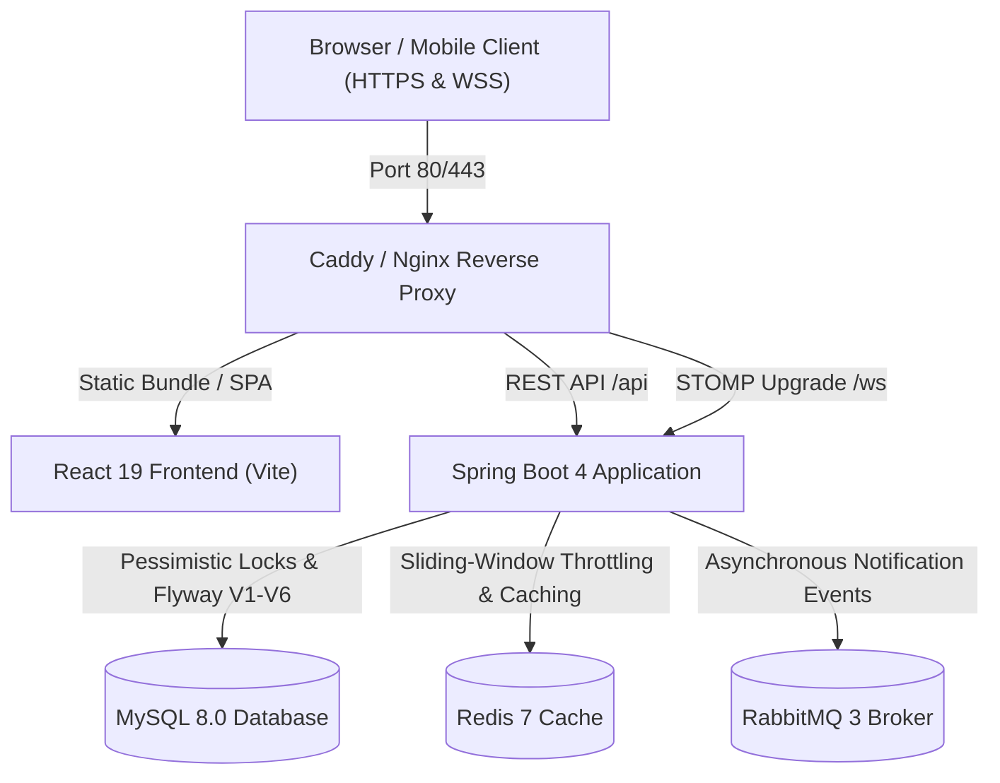

# LifeLink — Emergency Blood Donor Response Platform

[](https://github.com/HarshadRawat/lifelink-blood-donor-system/actions/workflows/ci.yml)
[](https://codecov.io/gh/HarshadRawat/lifelink-blood-donor-system)
[](https://openjdk.org/)
[](https://spring.io/projects/spring-boot)
[](https://react.dev/)
[](https://www.mysql.com/)
[](docs/DEPLOYMENT.md)

> Real-time emergency blood coordination platform pairing indexed B-Tree geolocation and ABO/Rh physiological compatibility filtering with STOMP WebSocket push alerts, row-level pessimistic locking, and privacy-first consent-driven contact sharing.

---

## Live Demo & Verified Credentials

* **Live Demo**: [https://lifelink.onrender.com](https://lifelink.onrender.com) *(Free-tier web service may take up to one minute to wake on initial access)*
* **Swagger API Documentation**: [https://lifelink-backend.onrender.com/swagger-ui.html](https://lifelink-backend.onrender.com/swagger-ui.html)
* **Architecture & Decision Records**: [DECISIONS.md](DECISIONS.md) &nbsp;|&nbsp; **Operational Runbook**: [docs/RUNBOOK.md](docs/RUNBOOK.md)

| Role | Email | Password | Pre-Configured State (Central Bengaluru) |
| :--- | :--- | :--- | :--- |
| **Hospital** | `hospital@lifelink.com` | `Hospital123!` | City Care Hospital, 1 active A+ emergency request (2 units needed) |
| **Donor (Direct Match)** | `alice.donor@lifelink.com` | `Donor123!` | A+ donor, 0.5 km away, pending emergency broadcast alert |
| **Donor (Universal)** | `bob.donor@lifelink.com` | `Donor123!` | O- donor, 0.8 km away, accepted with contact sharing consent |
| **Donor (Incompatible)** | `charlie.donor@lifelink.com` | `Donor123!` | B+ donor, 4.5 km away, filtered out by ABO compatibility engine |

---

## Core Capabilities

- **Two-Tier Geolocation Pre-Filtering**: Evaluates candidates with a composite B-Tree index bounding-box filter in MySQL before running in-memory Haversine distance math on remaining candidates, delivering 12.5 ms median matching on 100,000 donors.
- **Event-Driven Push Dispatch**: Decouples hospital request creation from notification distribution via RabbitMQ (AMQP) with exponential retry backoff and dead-letter queue (DLQ) protection.
- **Real-Time WebSocket Alerts**: Pushes instant notifications to donors over Spring STOMP WebSockets, defended by mid-session token expiration tracking.
- **Row-Level Concurrency Defense**: Uses MySQL `SELECT ... FOR UPDATE` pessimistic locks on the emergency request row during donor acceptance, preventing over-fulfillment when dozens of donors accept simultaneously (proven with 32 concurrent threads).
- **Privacy-First & Right to be Forgotten**: Donor phone numbers and emails are masked until explicit donor consent is granted; users can permanently purge their account and personal data at any time via `DELETE /api/users/me`.
- **Hardened Security Architecture**: 15-minute access tokens, refresh token rotation with token family reuse invalidation, 5-attempt account lockout, CIDR trusted proxy resolution, and blocking Trivy vulnerability scanning.

---

## Architecture



---

## Run Locally in 3 Commands

Prerequisites: [Docker Desktop](https://www.docker.com/products/docker-desktop/) (Docker Compose v2+).

```bash
# 1. Clone repository
git clone https://github.com/HarshadRawat/lifelink-blood-donor-system.git && cd lifelink-blood-donor-system

# 2. Configure environment with non-default secrets
cp .env.example .env

# 3. Start full production stack with demo records
docker compose -f docker-compose.yml -f docker-compose.demo.yml up -d --build
```

Access the application at [http://localhost](http://localhost) (REST API at [http://localhost:8080](http://localhost:8080), Swagger UI at [http://localhost:8080/swagger-ui.html](http://localhost:8080/swagger-ui.html)).

---

## Measured Performance

Benchmarked against **100,000 synthetic donor records** on MySQL 8.0 (full methodology in [docs/BENCHMARK.md](docs/BENCHMARK.md)):

| Metric | Full Table Scan (In-Memory Haversine) | Two-Tier B-Tree Pre-Filter | Measured Improvement |
| :--- | :---: | :---: | :---: |
| **Median Latency ($p50$)** | 116.21 ms | **12.53 ms** | **9.3x faster** |
| **95th Percentile ($p95$)** | 188.78 ms | **21.35 ms** | **8.8x faster** |
| **JVM Memory Allocated** | 35,424 records transferred | **162 records transferred** | **99.5% reduction** |
| **Matching Parity** | 131 qualified donors | **131 qualified donors** | **100% exact parity** |
| **k6 Concurrency Throughput** | — | **428.4 req/s** (50 VUs, $p95 = 18.75\text{ ms}$) | **Zero SLA violations** |

---

## Testing & Quality Assurance

LifeLink maintains a comprehensive test suite executed across every pull request:

```bash
# Backend verification: unit, service, concurrency and Testcontainers integration tests
cd blood-donor-system && ./mvnw verify

# Frontend verification: unit and component tests
cd frontend && npm test
```

* **243 Backend Tests**: Includes 32-thread concurrent acceptance tests on MySQL 8.0, refresh token family reuse revocation tests, and fixed-clock escalation tests.
* **50 Frontend Tests**: Vitest test suite covering dashboards, token refresh interceptors, and protected authentication flows.
* **Continuous Integration**: GitHub Actions runs `./mvnw -B verify`, asserts concurrency test execution, uploads JaCoCo reports to Codecov, and runs automated Trivy container vulnerability scans.

---

## Architectural Decision Records & Engineering Trade-Offs

Key decisions and documented trade-offs are detailed in [DECISIONS.md](DECISIONS.md):
- **[ADR 012 & 017](DECISIONS.md#adr-012)**: Row-level pessimistic locking (`SELECT ... FOR UPDATE`) vs. optimistic locking retry storms under high multi-donor acceptance contention.
- **[ADR 015](DECISIONS.md#adr-015)**: Account lockout defense vs. denial-of-service abuse (combining per-IP rate limiting with short lockout intervals).
- **[ADR 016](DECISIONS.md#adr-016)**: Frame-driven WebSocket token expiry vs. continuous connection polling.
- **[ADR 018](DECISIONS.md#adr-018)**: Escalation cadence tracking (`last_escalated_at`) and single-instance vs. distributed ShedLock scheduling.
- **[ADR 019](DECISIONS.md#adr-019)**: Post-commit event publishing vs. full Transactional Outbox pattern with Debezium CDC.
- **[ADR 020](DECISIONS.md#adr-020)**: Cloud VM orchestration with Docker Compose & Caddy vs. PaaS cold-start limitations.
- **[ADR 021](DECISIONS.md#adr-021)**: Auxiliary dependency resilience: fail-open rate limiting and separated liveness/readiness actuator probes.
- **[ADR 022](DECISIONS.md#adr-022)**: Strict MySQL schema evolution via Flyway migrations (V1-V6) for column-level ENUMs.

---

## Engineering Roadmap

- [ ] **Transactional Outbox Pattern**: Replace post-commit event publishing with an `outbox_events` table and Debezium CDC for guaranteed at-least-once message delivery.
- [ ] **Spatial Indexing with PostGIS**: Migrate bounding-box coordinates to spatial R-Tree / PostGIS `ST_DWithin` indexing for global geographic scale.
- [ ] **Multi-Node Scheduler Locking**: Integrate ShedLock for horizontally scaled multi-container backend clusters.
- [ ] **Kubernetes Deployment**: Author Helm charts with automated HPA scaling and ingress controllers.
