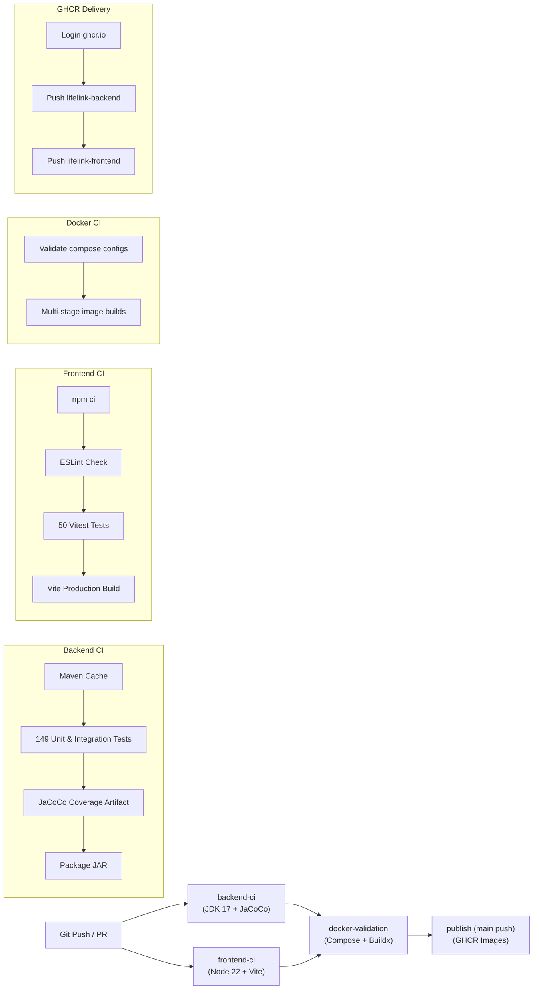

# LifeLink — Blood Donor Emergency Response System

[](https://github.com/HarshadRawat/lifelink-blood-donor-system/actions/workflows/ci.yml)
[-brightgreen.svg)](blood-donor-system/target/site/jacoco/index.html)
[](https://openjdk.org/)
[](https://spring.io/projects/spring-boot)
[](https://react.dev/)
[](https://vitejs.dev/)
[](https://www.mysql.com/)
[](DOCKER.md)
[](https://github.com/HarshadRawat/lifelink-blood-donor-system/pkgs/container/lifelink-backend)
[](#testing--quality-assurance)
[-brightgreen.svg)](docs/BENCHMARK.md)

LifeLink is an emergency blood coordination platform built with Java Spring Boot and React. It bridges the critical latency gap between hospital blood shortages and nearby eligible donors using geolocation radius search, biological blood compatibility matrix matching, real-time push notifications over WebSockets, and privacy-first contact sharing. Detailed architecture documentation is maintained in [docs/IMPLEMENTATION.md](docs/IMPLEMENTATION.md), and architectural decisions are tracked in [DECISIONS.md](DECISIONS.md).

---

## Table of Contents

1. [Problem Statement & Objectives](#problem-statement--objectives)
2. [Key Features](#key-features)
3. [User Roles & Permissions](#user-roles--permissions)
4. [Technology Stack](#technology-stack)
5. [System Architecture](#system-architecture)
6. [Repository Structure](#repository-structure)
7. [Prerequisites](#prerequisites)
8. [Quick Start & Setup](#quick-start--setup)
9. [CI/CD Pipeline (GitHub Actions)](#cicd-pipeline-github-actions)
10. [Environment Configuration](#environment-configuration)
11. [API, Swagger & Health Probes](#api-swagger--health-probes)
12. [Testing & Quality Assurance](#testing--quality-assurance)
13. [Security & Privacy Design](#security--privacy-design)
14. [Troubleshooting](#troubleshooting)
15. [Contributing](#contributing)
16. [License](#license)

---

## Problem Statement & Objectives

During medical emergencies, trauma care, and surgeries, hospitals often face acute shortages of specific blood groups. Traditional manual donor registries rely on static telephone directories and broadcast calls, leading to:
* **High latency**: Hours spent locating eligible donors.
* **Geographical inefficiency**: Contacting donors located too far away to arrive in time.
* **Compatibility mismatches**: Incompatible donor types being called.
* **Privacy concerns**: Exposing donor personal contact details publicly without consent.

**LifeLink solves this through:**
* Automated geolocation filtering using the **Haversine great-circle distance algorithm** ($\le 20.0\text{ km}$ radius).
* Medical **ABO/Rh compatibility matrix matching** ensuring accurate physiological compatibility.
* **Sub-second push notifications** delivered via STOMP WebSockets directly to matching donors.
* **Secure, consent-driven contact sharing**: Donor phone and email addresses remain masked until the donor explicitly accepts the request and grants consent to coordinate.
* **Brute-force protection & sliding-window rate limiting**: Throttles credential guessing attempts on authentication endpoints.

---

## Key Features

* **Hospital Emergency Request Portal**:
  * Broadcast emergency blood requests with blood type, units needed, and urgency level (`CRITICAL`, `HIGH`, `MEDIUM`, `LOW`).
  * Automatic browser geolocation capture or manual coordinate positioning.
  * Real-time tracking of matched donors and fulfillment status.
* **Algorithmic Matching Engine**:
  * Distance calculation using the Haversine equation ($R = 6371\text{ km}$).
  * Full ABO & Rh biological compatibility matrix ($O^-$ universal donor; $AB^+$ universal recipient).
  * Ranked donor matching (nearest eligible donors prioritized).
  * Duplicate match suppression.
* **Donor Control Center**:
  * Availability toggle (`AVAILABLE` / `UNAVAILABLE`).
  * Instant emergency request match view with demanding hospital name, city, and urgency.
  * Informed acceptance & decline controls with explicit contact-sharing consent disclosure.
* **Real-time Push Notifications**:
  * STOMP protocol over WebSocket with secure JWT handshake authentication.
  * Unread count badges, in-app notification drawer, and auto-dismiss alerts.
* **Concurrency Control & Safety**:
  * Optimistic concurrency locking (`@Version`) preventing race conditions during concurrent request updates.
  * Spring Data JPA Specifications enabling composable multi-criteria dynamic filtering and database pagination (`LIMIT/OFFSET`).
* **Production Observability & Resilience**:
  * **Spring Boot Actuator**: Native `/actuator/health` liveness and readiness probes checking database connectivity in milliseconds.
  * **Brute-Force Rate Limiting**: In-memory, thread-safe sliding-window filter (`10 requests / 60 seconds` per IP) returning HTTP 429 on abuse.

---

## User Roles & Permissions

| Role | Access Permissions |
| :--- | :--- |
| `ROLE_HOSPITAL` | Create/manage emergency blood requests, trigger donor matching, access contact details of accepted donors, mark donation fulfilled. |
| `ROLE_DONOR` | Manage donor profile, toggle donation availability, receive real-time match alerts, accept/decline match with contact sharing consent. |
| `ROLE_ADMIN` | System administrative oversight, platform KPI metrics, cross-hospital emergency request monitoring, and registered user directory (Initial seed account for local development: `admin@lifelink.com`, configurable via environment variables in production). |

---

## Demo Logins & Instant Evaluation

To evaluate LifeLink immediately without manual setup, the platform includes a pre-seeded Bengaluru test cluster (`SPRING_PROFILES_ACTIVE=demo` or `DEMO_SEED_ENABLED=true`). You can also click the **⚡ Quick Demo Logins** autofill buttons directly on the login screen:

| Persona | Email | Password | Pre-seeded Scenario |
| :--- | :--- | :--- | :--- |
| 🏥 **Hospital** | `hospital@lifelink.com` | `Hospital123!` | **City Care Hospital** (Koramangala, Bengaluru). Has an active `CRITICAL` request for A+ blood. |
| 🩸 **Donor (Compatible)** | `alice.donor@lifelink.com` | `Donor123!` | **Alice Sharma** (A+ blood, 0.5 km away). Matched to hospital request; test the consent & contact unlock flow. |
| 🩸 **Donor (Universal)** | `bob.donor@lifelink.com` | `Donor123!` | **Bob Rao** (O- universal donor, 0.8 km away). Accepted request with contact sharing consent pre-granted. |
| 🛡️ **Administrator** | `admin@lifelink.com` | `Admin123` | System admin dashboard showing platform-wide health metrics and user audit trail. |

> Complete deployment architecture, cloud hosting instructions (VM, Render, Vercel), and SSL configuration are detailed in [docs/DEPLOYMENT.md](docs/DEPLOYMENT.md).

---

## Technology Stack

### Backend
* **Language**: Java 17+
* **Framework**: Spring Boot 4.1.1
* **Security**: Spring Security 6, JJWT 0.12.6 (stateless HMAC-SHA JWT), Rate Limiting Filter
* **Observability**: Spring Boot Starter Actuator (Liveness/Readiness probes)
* **Data Access**: Spring Data JPA, Hibernate ORM 7, MySQL Connector/J
* **Database & Migrations**: MySQL 8.0+ (Production) / Flyway 12 Database Migrations / Testcontainers MySQL 8.0 (Integration Tests) / In-Memory H2 (Unit & Mock Tests)
* **Distributed Cache & Rate Limiting**: Redis 7 Alpine (Distributed rate limiter counters via atomic INCR+EXPIRE & hot path caching with resilient in-memory fallback)
* **Real-time**: Spring WebSocket, STOMP messaging broker (`SimpMessagingTemplate`)
* **API Documentation**: SpringDoc OpenAPI 3.0.3 / Swagger UI
* **Build Tool**: Maven 3.9+ (includes Maven Wrapper `mvnw`)

### Frontend
* **Core**: React 19.2.8
* **Build & Dev Tool**: Vite 8.3.4
* **Testing**: Vitest 5.1.0, React Testing Library, `@testing-library/jest-dom`, JSDOM
* **Routing**: React Router DOM 7.18.4
* **Icons**: Lucide React 1.54.0
* **WebSocket Client**: `@stomp/stompjs` 7.3.0
* **Styling**: Vanilla CSS design system with responsive design tokens

---

## System Architecture

```
┌────────────────────────────────────────────────────────────────────────┐
│                        LifeLink Architecture                           │
├────────────────────────────────────────────────────────────────────────┤
│                           React 19 Frontend                            │
│           (Donor Dashboard / Hospital Portal / Real-time Alerts)       │
└───────────────────────────┬────────────────────────────────────────────┘
                            │  HTTP REST / WebSocket STOMP
                            ▼
┌────────────────────────────────────────────────────────────────────────┐
│                     Nginx Reverse Proxy (Port 80)                      │
│      • Static asset caching  • REST API proxy  • WebSocket upgrade     │
│      • /swagger-ui/ proxy   • /actuator/health container probes        │
└───────────────────────────┬────────────────────────────────────────────┘
                            │
                            ▼
┌────────────────────────────────────────────────────────────────────────┐
│                 Spring Boot 4 Application Boundary                     │
├────────────────────────────────────────────────────────────────────────┤
│  Security & Guard Layer:                                               │
│    • RateLimitingFilter (Sliding-window IP throttling for /api/auth/*) │
│    • JwtFilter (Stateless Bearer token validation)                     │
│    • WebSocketAuthInterceptor (CONNECT frame token verification)       │
│    • Method Security (@PreAuthorize role guards)                       │
├────────────────────────────────────────────────────────────────────────┤
│  Core Services:                                                        │
│    • DonorMatchingService (Haversine equation & ABO/Rh matrix)         │
│    • EmergencyRequestService (JPA Specifications & Version locking)    │
│    • NotificationService (STOMP WebSocket push messaging)             │
│    • Actuator Endpoint Service (/actuator/health)                      │
├────────────────────────────────────────────────────────────────────────┤
│  Data Layer:                                                           │
│    • Spring Data JPA Repositories                                      │
│    • Optimistic Locking (@Version on EmergencyRequest)                 │
│    • MySQL Database (InnoDB storage engine)                            │
└────────────────────────────────────────────────────────────────────────┘
```

---

## Repository Structure

```
blood-donor-system/
├── .github/
│   └── workflows/
│       └── ci.yml                   # GitHub Actions CI/CD Pipeline
├── blood-donor-system/              # Spring Boot Backend & React Frontend
│   ├── frontend/                    # React 19 + Vite Application
│   │   ├── src/
│   │   │   ├── api/                 # API client & fetch interceptors
│   │   │   ├── components/          # Reusable UI components, Badges, Modals
│   │   │   ├── context/             # AuthContext & NotificationContext (STOMP)
│   │   │   ├── pages/               # Hospital, Donor, Admin, & Info dashboards
│   │   │   ├── test/                # 50 Automated Vitest unit & component tests
│   │   │   │   ├── AuthContext.test.jsx
│   │   │   │   ├── Badges.test.jsx
│   │   │   │   ├── DonorDashboard.test.jsx
│   │   │   │   ├── HospitalDashboard.test.jsx
│   │   │   │   ├── Modal.test.jsx
│   │   │   │   ├── ProtectedRoute.test.jsx
│   │   │   │   └── setup.js
│   │   │   └── utils/               # Coordinate & request utilities
│   │   ├── Dockerfile               # Production multi-stage frontend Dockerfile
│   │   ├── Dockerfile.dev           # Development hot-reload frontend Dockerfile
│   │   ├── nginx.conf               # Production Nginx reverse proxy configuration
│   │   ├── package.json             # Frontend dependencies & test scripts
│   │   ├── vite.config.js           # Vite dev proxy & Vitest configuration
│   │   └── eslint.config.js         # ESLint configuration
│   ├── src/
│   │   ├── main/java/com/example/blooddonor/
│   │   │   ├── config/              # Security, OpenAPI, & WebSocket configuration
│   │   │   ├── controller/          # REST Controllers
│   │   │   ├── dto/                 # Request & Response Data Transfer Objects
│   │   │   ├── entity/              # JPA Entities (Optimistic locking & Enums)
│   │   │   ├── exception/           # Global exception handling
│   │   │   ├── repository/          # Spring Data JPA Repositories & Specifications
│   │   │   ├── security/            # JwtFilter & RateLimitingFilter
│   │   │   └── service/             # Domain logic (Haversine, Matching, Notif)
│   │   └── test/java/com/example/blooddonor/
│   │       ├── controller/          # Controller slice tests
│   │       ├── integration/         # Concurrency & Lifecycle integration tests
│   │       ├── security/            # Security, JWT, Actuator & Rate limit tests
│   │       └── service/             # Service unit tests
│   ├── pom.xml                      # Maven project configuration
│   └── mvnw / mvnw.cmd              # Maven wrappers
├── docs/                            # Deep Architecture & API Guides
│   ├── ARCHITECTURE.md              # Detailed architecture breakdown
│   ├── API.md                       # REST API endpoint reference
│   └── SECURITY.md                  # Security model & privacy standards
├── docker-compose.yml               # Production multi-service orchestration
├── docker-compose.dev.yml           # Development live-reload overlay
├── .env.example                     # Root environment configuration template
├── .gitignore                       # Root Git ignore rules
└── README.md                        # Project documentation
```

---

## Prerequisites

* **Java Development Kit (JDK)**: JDK 17 or higher
* **Node.js**: v20.0.0 or higher (v22+ LTS recommended)
* **npm**: v9.0.0 or higher
* **MySQL Server**: 8.0 or higher (or Docker)
* **Ports**: `80` (Docker Gateway), `8080` (Backend API), and `5173` (Frontend Dev Server)

---

## Quick Start & Setup

### Option 1: Run with Docker Compose (Recommended)

Run the entire full-stack application (MySQL 8.0, Spring Boot backend, and React Nginx frontend) in isolated containers with a single command:

```powershell
# 1. (Optional) Copy example Docker environment configuration
cp .env.docker.example .env

# 2. Build and run all containers in background
docker compose up -d --build
```

* **Frontend Web Portal**: [http://localhost](http://localhost) (Port 80)
* **Swagger UI API Docs**: [http://localhost/swagger-ui.html](http://localhost/swagger-ui.html)
* **Backend Health Probe**: [http://localhost/actuator/health](http://localhost/actuator/health)
* **Direct Backend API**: [http://localhost:8080/swagger-ui.html](http://localhost:8080/swagger-ui.html)

#### Development Live-Reload Mode:
```powershell
docker compose -f docker-compose.yml -f docker-compose.dev.yml up
```

---

### Option 2: Local Manual Setup (Non-Docker)

#### 1. Database Setup
Log into your MySQL terminal or GUI and create the database:
```sql
CREATE DATABASE blood_donor_system CHARACTER SET utf8mb4 COLLATE utf8mb4_unicode_ci;
```

#### 2. Configure Environment
Set environment variables or copy `.env.example`:
```powershell
$env:DB_USERNAME="root"
$env:DB_PASSWORD="your_mysql_password"
```

#### 3. Start the Backend
Navigate to the project root and run Spring Boot:
```powershell
cd blood-donor-system
.\mvnw.cmd spring-boot:run
```
The backend starts at `http://localhost:8080`.

#### 4. Start the Frontend
In a separate terminal:
```powershell
cd blood-donor-system/frontend
npm install
npm run dev
```
Open **`http://localhost:5173`** in your browser.

---

## CI/CD Pipeline (GitHub Actions)

LifeLink includes an automated continuous integration and delivery pipeline defined in [`.github/workflows/ci.yml`](.github/workflows/ci.yml). The pipeline automatically triggers on pushes and pull requests to `main`, `master`, and `develop` branches:



### Pipeline Jobs Overview:
1. **`backend-ci` (Java 17 / Maven)**: Runs the complete 149-test suite, executes JaCoCo code coverage analysis (generating HTML/XML/CSV reports uploaded as workflow artifacts), and packages the production executable JAR.
2. **`frontend-ci` (Node 22 / Vite)**: Executes automated ESLint verification, 50 Vitest component tests, and builds optimized static assets.
3. **`docker-validation` (Docker Compose & Buildx)**: Validates production and development Docker Compose configurations and verifies multi-stage Docker build files.
4. **`publish` (GHCR Container Delivery)**: Runs exclusively on pushes/merges to `main`, publishing versioned and `latest` container images to GitHub Container Registry (`ghcr.io/harshadrawat/lifelink-backend` and `ghcr.io/harshadrawat/lifelink-frontend`).
5. **Dependabot Automated Maintenance**: Configured via [`.github/dependabot.yml`](.github/dependabot.yml) to audit and update Maven backend dependencies, npm frontend packages, and GitHub Actions weekly.

---

## Environment Configuration

| Variable | Description | Default | Scope |
| :--- | :--- | :--- | :--- |
| `PORT` | Backend server HTTP port | `8080` | Backend |
| `SPRING_PROFILES_ACTIVE` | Active Spring profiles (`prod`, `demo`, `dev`) | `default` | Backend |
| `DB_URL` | JDBC MySQL connection URL | `jdbc:mysql://localhost:3306/blood_donor_system` | Backend |
| `DB_USERNAME` | MySQL database username | `root` | Backend |
| `DB_PASSWORD` | MySQL database password | `your_mysql_password` | Backend |
| `REDIS_HOST` | Redis cache and rate limiting hostname | `localhost` (Compose: `redis`) | Backend |
| `REDIS_PORT` | Redis cache and rate limiting port | `6379` | Backend |
| `JPA_DDL_AUTO` | Hibernate schema mode (`update`, `validate`, `none`) | `validate` | Backend |
| `FLYWAY_ENABLED` | Enable Flyway database migrations | `true` | Backend |
| `FLYWAY_BASELINE_ON_MIGRATE` | Baseline existing schema if not empty | `false` | Backend |
| `JWT_SECRET` | 256/384-bit cryptographic signing key | Configured key | Backend |
| `JWT_EXPIRATION_MS` | JWT validity in milliseconds | `86400000` (24h) | Backend |
| `CORS_ALLOWED_ORIGINS` | Comma-separated allowed CORS origins/patterns | `http://localhost,http://127.0.0.1` | Backend |
| `DEMO_SEED_ENABLED` | Enable automatic Bangalore demo cluster seeding | `false` | Backend |
| `RATE_LIMIT_ENABLED` | Enable authentication endpoint rate limiting | `true` | Backend |
| `RATE_LIMIT_LOGIN_MAX` | Max login/register attempts per IP window | `10` | Backend |
| `RATE_LIMIT_LOGIN_WINDOW` | Sliding window duration in seconds | `60` | Backend |
| `RATE_LIMIT_TRUSTED_PROXIES` | Comma-separated trusted reverse proxy IPs | `127.0.0.1,0:0:0:0:0:0:0:1,::1` | Backend |
| `ADMIN_EMAIL` | Default system administrator email | `admin@lifelink.com` | Backend |
| `ADMIN_PASSWORD` | Default system administrator password | Configured secret | Backend |
| `VITE_API_BASE_URL` | Frontend REST API base URL | Empty (uses proxy) | Frontend |

---

## API, Swagger & Health Probes

### Interactive API Documentation:
* **Swagger UI (via Gateway)**: [http://localhost/swagger-ui.html](http://localhost/swagger-ui.html)
* **Swagger UI (Direct)**: [http://localhost:8080/swagger-ui.html](http://localhost:8080/swagger-ui.html)
* **OpenAPI 3 JSON**: [http://localhost:8080/v3/api-docs](http://localhost:8080/v3/api-docs)

### Container Health & Observability:
* **Actuator Health Check**: `GET http://localhost/actuator/health`
  Returns `{"status": "UP"}` with active database connectivity verification.
* **Frontend Gateway Probe**: `GET http://localhost/health`
  Returns `200 OK` ("healthy").

---

## Testing & Quality Assurance

LifeLink maintains a full suite of **207 automated tests** (157 backend tests across controllers, services, security, concurrency, demo initialization, geolocation boundary conditions, and lifecycle integration + 50 frontend component tests):

### 1. Frontend Automated Tests (Vitest + React Testing Library)
A suite of **50 automated frontend tests** covering UI components, state contexts, authentication routing, and core user dashboards:

```powershell
cd blood-donor-system/frontend
npm test
```

* `Badges.test.jsx` (13 tests): Badge status rendering, color variants, fallbacks.
* `AuthContext.test.jsx` (5 tests): Login, logout, registration, session persistence.
* `Modal.test.jsx` (4 tests): Portal rendering, escape key listener, backdrop dismissal.
* `ProtectedRoute.test.jsx` (3 tests): Role guards, unauthenticated redirect.
* `DonorDashboard.test.jsx` (12 tests): Incomplete profile prompt, availability toggle, emergency match list, consent disclosure modal, request decline.
* `HospitalDashboard.test.jsx` (13 tests): Profile required guard, broadcast blood request form, algorithmic match trigger, request fulfillment, cancellation.

Run linting and production bundle check:
```powershell
npm run lint    # ESLint verification (0 errors)
npm run build   # Production asset compilation
```

### 2. Backend Automated Tests (JUnit 5 + Mockito + Testcontainers MySQL 8 + In-Memory H2)
**157 automated backend tests** covering controllers, services, repositories, security authorization, concurrency, demo seeding, and emergency lifecycle:

```powershell
cd blood-donor-system
.\mvnw.cmd test
```

* **Two-Tier Geolocation Matching & Boundary Tests (`DonorMatchingServiceTest` - 30 tests)**:
  * Tests #60 to #64: Validates $\mathcal{O}(1)$ bounding-box candidate query (`findCandidates`), exact Haversine refinement ($\le 20.0\text{ km}$), nearest-first distance sorting, boundary conditions (19.8 km included vs. 20.2 km excluded), and corner-candidate elimination where donors inside the bounding box range but exceeding the 20 km circular radius are safely pruned.
* **Testcontainers MySQL 8.0 Integration (`AbstractMySqlIT`)**:
  * Managed MySQL 8.0 container annotated with `@Testcontainers(disabledWithoutDocker = true)` for seamless local-to-CI portability.
  * Dynamic JDBC configuration via Spring Boot `@ServiceConnection`.
  * Real Flyway V1 and V2 migrations executed directly against the container with `spring.jpa.hibernate.ddl-auto=validate` to verify production schema fidelity.
  * `EmergencyRequestConcurrencyTest` (1 test): Validates JPA `@Version` optimistic locking under concurrent updates against real MySQL InnoDB engine without H2 emulation. Configured with `@AutoConfigureTestDatabase(replace = AutoConfigureTestDatabase.Replace.NONE)` to prevent embedded database substitution.
  * `EmergencyLifecycleIntegrationTest` (1 test): Validates the complete 8-step emergency workflow end-to-end against real MySQL (Hospital registration -> Donor matching via Haversine & ABO -> Contact privacy masking -> Donor consent -> Revealed contact -> Fulfillment).
* **Unit & Mock MVC Suites (Fast Inner-Loop Feedback)**:
  * `RateLimitingFilterTest` (7 tests): Verifies sliding-window IP throttling, HTTP 429 response enforcement, reverse proxy header extraction, and spoofing resistance.
  * `DemoDataInitializerTest` (3 tests): Verifies idempotent seeding of Bengaluru demo cluster and conditional profile activation.
  * `ActuatorSecurityTest` (2 tests): Validates public health access and protection of sensitive internal metrics.
  * `JwtFilterTest` & `JwtSecurityIntegrationTest` (11 tests): Token verification, expiration, malformed token handling, and role extraction.
  * Controller & Service Unit Tests (132 tests): Full Mockito coverage across donor, hospital, emergency request, notification, admin, and user management flows.

### 3. 100,000 Donor Geolocation Benchmark Suite
LifeLink includes a dedicated benchmark suite measuring matching latency on 100,000 synthetic donor records across MySQL 8.0:
```powershell
.\mvnw.cmd org.codehaus.mojo:exec-maven-plugin:3.7.0:java `
  "-Dexec.mainClass=com.example.blooddonor.benchmark.DonorMatchingBenchmark" `
  "-Dexec.classpathScope=test"
```
* **Performance Gain**: Cut median matching latency from **116.21 ms to 12.53 ms (9.3x speedup)** and 95th percentile latency from **188.78 ms to 21.35 ms (8.8x speedup)**.
* **Memory Reduction**: Reduced candidate rows loaded into the JVM from **35,424 rows to 162 rows (99.5% reduction)**.
* Detailed analysis, MySQL `EXPLAIN` query execution plans, and architectural trade-offs are documented in [docs/BENCHMARK.md](docs/BENCHMARK.md).

---

## Security & Privacy Design

1. **Context-Derived Principals**: Authenticated user IDs are extracted directly from `SecurityContextHolder.getContext().getAuthentication().getPrincipal()`. The server never trusts client-supplied IDs.
2. **Defensive PII Exposure**: Contact information (telephone numbers and emails) is masked at the service level and only revealed when the donor explicitly marks their match as `ACCEPTED` with consent.
3. **Brute-Force & Credential Stuffing Defense**: `RateLimitingFilter` enforces a 10 req/min sliding-window limit per IP on `/api/auth/login` and `/api/auth/register` with `X-Forwarded-For` proxy resolution.
4. **IDOR Prevention**: Emergency request ownership checks verify that the requesting hospital owns the target request before permitting match or contact inspection.
5. **Optimistic Locking**: JPA `@Version` on emergency requests prevents race conditions when concurrent users update blood request status or units.

For complete security specifications, see [docs/SECURITY.md](docs/SECURITY.md).

---

## Troubleshooting

* **Swagger UI 404 on Assets**: Handled by Nginx `^~ /swagger-ui/` preferential prefix matching in `nginx.conf`.
* **MySQL Connection Refused**: Verify MySQL is running on port 3306 (or 3307 in Docker) and database `blood_donor_system` exists.
* **WebSocket Connection Blocked**: `WebSocketConfig` includes allowed origin patterns for `http://localhost`, `http://localhost:*`, `http://127.0.0.1:*`.
* **Port Conflicts**: Pass custom ports via `.env` (`BACKEND_PORT=8081`, `FRONTEND_PORT=8080`, `MYSQL_PORT=3308`).

---

## Contributing

Please review [CONTRIBUTING.md](CONTRIBUTING.md) for details on code style, branch naming conventions, and the pull request checklist.

---

## License

Distributed for educational and development purposes.
