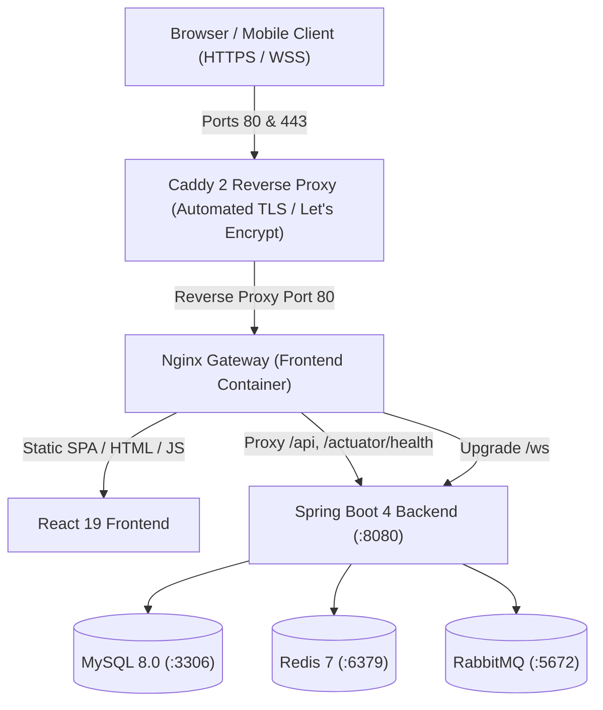

# LifeLink — Production Deployment & Live Demo Guide

This guide details the deployment options, environment variables, security configurations, demo data seeding, and monitoring strategies for LifeLink.

---

## 1. Deployment Architecture Overview

LifeLink's production architecture is designed for deployment on a single cloud VM running Docker Compose behind Caddy for automated TLS/HTTPS:



> [!NOTE]
> In this architecture, **only Caddy publishes ports (80 and 443)** to the public internet. All internal services (`mysql`, `redis`, `rabbitmq`, and `backend`) reside strictly within the internal Docker bridge network (`172.28.0.0/16`).

---

## 2. Recommended Production Deployment: Cloud VM with Caddy HTTPS

A cloud virtual machine (e.g. AWS EC2 t3.small, Oracle Cloud Always Free ARM/x86, DigitalOcean Droplet, or Hetzner VPS with >= 2 GB RAM) provides the ideal environment for LifeLink. It avoids the cold-start delays, WebSocket termination limits, and missing MySQL support of free-tier PaaS offerings.

### Step 1: Provision Cloud VM & Install Docker
Provision an Ubuntu 22.04 or 24.04 LTS instance. Configure the cloud security group / firewall to open:
- Port `22` (SSH - restricted to your administrator IP)
- Port `80` (HTTP - required for ACME challenge and HTTP-to-HTTPS redirect)
- Port `443` (HTTPS - public secure traffic)

Install Docker and Caddy:
```bash
sudo apt update && sudo apt install -y docker.io docker-compose-plugin git caddy
sudo usermod -aG docker $USER
```

### Step 2: Configure Caddy Reverse Proxy with Automatic HTTPS
Point your domain or free dynamic DNS hostname (e.g. `lifelink.yourdomain.com`) to the VM's public IP address via an `A` record.

Edit `/etc/caddy/Caddyfile`:
```caddyfile
lifelink.yourdomain.com {
    reverse_proxy 127.0.0.1:80 {
        header_up Host {host}
        header_up X-Real-IP {remote_host}
        header_up X-Forwarded-For {remote_host}
        header_up X-Forwarded-Proto https
    }
}
```
Reload Caddy:
```bash
sudo systemctl reload caddy
```
Caddy will automatically provision and renew zero-configuration Let's Encrypt / ZeroSSL TLS certificates.

### Step 3: Clone Repository & Configure Environment
```bash
git clone https://github.com/HarshadRawat/lifelink-blood-donor-system.git
cd lifelink-blood-donor-system

# Create .env from template
cp .env.example .env

# Generate secure cryptographic secrets
openssl rand -base64 48
```
Edit `.env` and fill in strong passwords for:
- `JWT_SECRET`: Minimum 32 characters (e.g. generated via `openssl rand -base64 48`)
- `DB_ROOT_PASSWORD` and `DB_PASSWORD`: Strong unique database passwords
- `REDIS_PASSWORD` and `RABBITMQ_PASSWORD`: Authentication credentials for cache and broker
- `CORS_ALLOWED_ORIGINS`: Set to your exact domain (`https://lifelink.yourdomain.com`)

### Step 4: Launch Production Stack
```bash
# Production mode (clean database, no demo records):
docker compose up -d --build

# Or with pre-seeded demo records for live evaluation:
docker compose -f docker-compose.yml -f docker-compose.demo.yml up -d --build
```

### Step 5: Verify Deployment and Client IP Propagation
Verify that all 5 services report healthy:
```bash
docker compose ps
```
Behind Caddy, Nginx receives the client IP via `X-Forwarded-For`. Nginx uses:
```nginx
set_real_ip_from 172.28.0.0/16;
set_real_ip_from 127.0.0.1;
real_ip_header X-Forwarded-For;
proxy_set_header X-Forwarded-For $remote_addr;
```
This ensures Spring Boot's CIDR-aware `ClientIpResolver` accurately inspects the true end-user IP for audit logs and rate-limiting (`rl:login:<real_ip>`), completely immune to IP spoofing.

---

## 3. Option B: Cloud PaaS Deployment (Render + Vercel)

### 1. Backend + Managed Database on Render
1. Fork or push this repository to GitHub.
2. In Render, select **Blueprints** -> **New Blueprint Instance**.
3. Point to this repo. Render automatically parses [`render.yaml`](../render.yaml), provisioning:
   * A managed MySQL database (`blood_donor_system`).
   * A containerized web service for `lifelink-backend`.
4. Ensure `SPRING_PROFILES_ACTIVE=prod,demo` and set `CORS_ALLOWED_ORIGINS` to include your Vercel frontend URL (e.g., `https://lifelink.vercel.app`).

### 2. Frontend on Vercel
1. Import the repository in [Vercel](https://vercel.com).
2. Set **Root Directory** to `blood-donor-system/frontend`.
3. Framework preset: **Vite**.
4. Set Environment Variable:
   * `VITE_API_BASE_URL`: `https://lifelink-backend.onrender.com` (your Render backend URL).
5. Deploy. Vercel automatically respects [`vercel.json`](../blood-donor-system/frontend/vercel.json) to handle SPA client-side route rewrites.

---

## 4. Pre-Configured Demo Credentials (Bengaluru Cluster)

When running with profile `demo` or `DEMO_SEED_ENABLED=true`, LifeLink automatically seeds a realistic geographic cluster in **Bengaluru (Koramangala)** to enable full matching, privacy, and notification testing in 30 seconds:

| Role | Email | Password | Details |
| :--- | :--- | :--- | :--- |
| 🏥 **Hospital** | `hospital@lifelink.com` | `Hospital123!` | **City Care Hospital** (Koramangala, 12.9352, 77.6245). Has an active CRITICAL request for A+ blood. |
| 🩸 **Donor 1 (Matched)** | `alice.donor@lifelink.com` | `Donor123!` | **Alice Sharma** (A+, 12.9380, 77.6290). Located **0.5 km** from hospital. Matched and pending consent. |
| 🩸 **Donor 2 (Accepted)** | `bob.donor@lifelink.com` | `Donor123!` | **Bob Rao** (O- universal donor, 12.9400, 77.6200). Located **0.8 km** away. Accepted with contact sharing consent. |
| 🩸 **Donor 3 (Excluded - ABO)** | `charlie.donor@lifelink.com` | `Donor123!` | **Charlie Kumar** (B+, 12.9250, 77.5850). ~4.5 km away, excluded due to ABO incompatibility. |
| 🩸 **Donor 4 (Excluded - ABO)** | `david.donor@lifelink.com` | `Donor123!` | **David Fernandes** (AB+, 12.9780, 77.6400). ~6.5 km away, AB+ universal recipient. |
| 🩸 **Donor 5 (Excluded - Distance)** | `emma.donor@lifelink.com` | `Donor123!` | **Emma Watson** (A+, 13.3400, 77.1000). Located in Tumkur (**~60 km** away, outside the 20 km radius). |

> [!NOTE]
> Demo accounts can also be instantly auto-filled on the login screen using the **⚡ Quick Demo Logins** button panel.

---

## 5. Uptime Monitoring & Free Host Sleep Prevention

Free cloud tiers (Render, Railway, Fly.io) put containers to sleep after 15 minutes of inactivity. To keep the service hot and responsive for recruiters:

1. Create a free account at [UptimeRobot](https://uptimerobot.com) or [Cron-job.org](https://cron-job.org).
2. Create an **HTTP Monitor**:
   * **URL**: `https://<your-backend-host>/actuator/health`
   * **Monitoring Interval**: Every `5 minutes`
   * **Expected Response Code**: `200 OK`
3. This sends a lightweight request to the Spring Boot Actuator probe every 5 minutes, preventing container sleep without degrading database quotas.

---

## 6. End-to-End Smoke Test Checklist

Once deployed, execute this 2-minute mobile verification flow:
1. Open your smartphone browser on mobile data (independent cellular network).
2. Visit `https://<deployed-site>/login`.
3. Click **🏥 Hospital** under Quick Demo Logins and sign in.
4. Verify that the active emergency request for A+ blood appears with 2 matched donors.
5. In a second incognito window or separate device, log in as **🩸 Donor A+** (`alice.donor@lifelink.com`).
6. Click **Accept Match** and toggle **Consent to share contact details**.
7. In the Hospital window, immediately observe:
   - WebSocket instant toast alert notification.
   - Alice's contact phone number (`+91-9876543210`) unlocked and visible.
8. Click **Mark Fulfilled** as Hospital. Verify the request status updates to `FULFILLED` across both screens.
