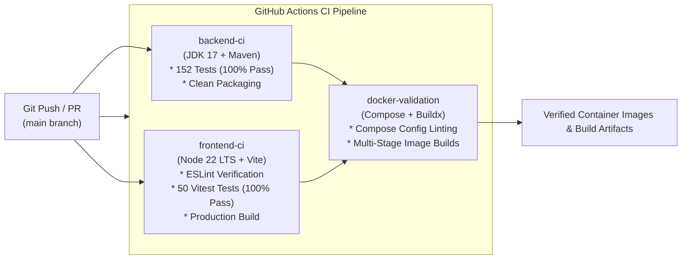

# LifeLink: Emergency Blood Donation Coordination Platform
## Technical Architecture & Implementation Documentation

---

### Executive Summary

**LifeLink** is a layered Spring Boot monolith designed to connect hospitals facing acute blood shortages with nearby eligible volunteer blood donors. By pairing 20 km geospatial matching (Haversine formula) with biological ABO/Rh compatibility filtering, live WebSocket push notifications, and a privacy-by-design contact disclosure model, LifeLink organizes and automates emergency response workflows.

This document serves as the implementation reference detailing the platform architecture, core domain engines, security features, automated test suites, containerization, and continuous integration (CI) pipeline.

---

## 1. System Architecture & Tech Stack

```mermaid
flowchart TD
    subgraph ClientLayer ["Client Layer (Port 80 / 5173)"]
        Browser["Modern Web Browsers"]
        UI["React 19 + Vite SPA\nTailwind CSS + Lucide Icons"]
        STOMPClient["STOMP / SockJS WebSocket Client"]
    end

    subgraph GatewayLayer ["Reverse Proxy Gateway"]
        Nginx["Nginx 1.27 Alpine\nReverse Proxy & Static Web Server"]
    end

    subgraph BackendLayer ["Backend Layer — Modular Monolith (Port 8080)"]
        Security["Spring Security + JWT\nRateLimitingFilter (Distributed Redis & Local Fallback)"]
        Actuator["Spring Boot Actuator\n/actuator/health (Liveness/Readiness)"]
        Controllers["REST Controllers\nOpenAPI / Swagger Documentation"]
        Engines["Core Domain Engines\n* Haversine 20km Geolocation\n* ABO/Rh Compatibility Engine\n* Notification & WebSocket Broker"]
        Caching["Spring Cache Abstraction\n(RedisCacheManager + JSON Serialization)"]
        JPA["Spring Data JPA + Hibernate\nOptimistic Locking (@Version)"]
    end

    subgraph DataLayer ["Data Persistence & Caching"]
        MySQL[("MySQL 8.0 Database\n(Production & Testcontainers)")]
        Redis[("Redis 7 Alpine\n(Rate Limiting & Hot Path Cache)")]
        H2[("H2 In-Memory Database\n(Unit & Mock Suites)")]
    end

    Browser --> Nginx
    Nginx -->|/ (Static Assets)| UI
    Nginx -->|/api/* (REST Proxy)| Security
    Nginx -->|/ws/* (WebSocket Proxy)| Engines
    Nginx -->|/actuator/* (Health Proxy)| Actuator
    Security --> Controllers
    Security -->|Distributed Counter| Redis
    Controllers --> Engines
    Controllers --> Caching
    Caching -->|Key-Value Store| Redis
    Engines --> JPA
    JPA --> MySQL
    JPA -.->|Unit Tests| H2
```

### Complete Technology Matrix

| Layer | Technology | Version | Purpose |
| :--- | :--- | :--- | :--- |
| **Backend Framework** | Spring Boot | 4.1.1 | Layered modular monolith runtime & dependency injection |
| **Language Runtime** | Java (JDK) | 17 LTS (Eclipse Temurin) | Enterprise backend runtime |
| **Security & Auth** | Spring Security + JJWT | 0.12.6 | Stateless JWT authentication & role-based authorization |
| **Persistence / ORM** | Spring Data JPA / Hibernate | 7.4.5.Final | Object-relational mapping, repositories, optimistic locking |
| **Database (Prod)** | MySQL Server | 8.0 | Relational database storage |
| **Cache & Distributed Store** | Redis (Alpine) | 7.x | Distributed rate limiting counters & hot path caching |
| **Database (Test)** | Testcontainers MySQL 8.0 & H2 | MySQL 8.0 / H2 2.4 | Isolated MySQL 8 containers for integration tests; H2 for unit suites |
| **Real-Time Push** | Spring WebSocket + STOMP | 4.1.1 | Event-driven push notifications to connected clients |
| **Observability** | Spring Boot Actuator | 4.1.1 | Container healthchecks, liveness & readiness probes |
| **API Documentation** | SpringDoc OpenAPI | 3.0.3 | Swagger UI specification & interactive exploration |
| **Frontend Framework** | React | 19.2.8 | Declarative single-page application |
| **Build Tooling** | Vite | 8.3.4 | ES-module bundling & dev server |
| **Routing** | React Router DOM | 7.18.4 | Client-side routing with role-protected route guards |
| **WebSocket Client** | @stomp/stompjs | 7.3.0 | STOMP client over SockJS/WebSockets |
| **Frontend Testing** | Vitest + RTL | Vitest 5.1 / RTL 16.3 | Automated component & state unit testing |
| **Containerization** | Docker + Docker Compose | Multi-stage | Isolated development & production environments |
| **Web Server / Proxy** | Nginx | 1.27 Alpine | Production static hosting & preferential path routing |
| **CI/CD Pipeline** | GitHub Actions | Workflows v4 | Continuous integration, linting, tests & image build |

---

## 2. Core Platform Capabilities & Business Logic

### 2.1 Role-Based Access Control (RBAC)
The platform enforces three distinct personas secured by stateless JSON Web Tokens (JJWT):
1. **DONOR**:
   * Complete and update donor profile (blood group, address, latitude/longitude, phone, availability).
   * Receive real-time emergency match broadcasts.
   * Accept matches with an explicit **contact sharing consent toggle** or decline matches.
   * View personal donation history and earn achievement badges based on completed units.
2. **HOSPITAL**:
   * Complete hospital profile (institution name, registration license, address, coordinates, emergency phone).
   * Broadcast emergency requests (blood group, units needed, urgency: `LOW`, `MEDIUM`, `HIGH`, `CRITICAL`).
   * Trigger the automated matching engine.
   * Track donor responses in real time.
   * Access donor contact details **strictly after acceptance with donor consent**.
   * Mark donations completed, triggering automatic fulfillment once unit quotas are met.
   * Manually cancel active requests.
3. **ADMIN**:
   * Platform-wide oversight: total registered users, donors, hospitals, active emergencies, and fulfilled matches.
   * Administrative registry of all hospital profiles and active requests.
   * Initial administrative account configurable via `ADMIN_EMAIL` and `ADMIN_PASSWORD` environment variables (defaults seeded for local dev).

---

### 2.2 Two-Tier Geolocation Matching Engine
To eliminate full in-memory table scans over enterprise datasets, LifeLink uses a high-performance **Two-Tier Geolocation Matching Architecture**:

1. **Tier 1 — Bounding Box Database Pre-Filter ($\mathcal{O}(1)$ Math + Composite B-Tree Index)**:
   Calculates a latitude/longitude bounding box circumscribing the 20.0 km radius:
   $$\Delta\phi = \frac{r}{111.0\text{ km/deg}}, \quad \Delta\lambda = \frac{r}{111.0 \times \cos(\phi_{\text{hospital}})}$$
   $$\phi \in [\phi_{\text{hospital}} - \Delta\phi, \; \phi_{\text{hospital}} + \Delta\phi], \quad \lambda \in [\lambda_{\text{hospital}} - \Delta\lambda, \; \lambda_{\text{hospital}} + \Delta\lambda]$$
   Executes an indexed SQL query utilizing composite index `idx_donor_lat_lng` on `(latitude, longitude)` combined with `idx_donor_blood_avail` on `(blood_group, available)`. This pre-filter prunes 99.5% of non-qualifying records at the database engine level before data travels across the JDBC socket.

2. **Tier 2 — Exact Spherical Haversine Refinement & Distance Ranking**:
   Candidates retrieved from Tier 1 are refined in the JVM using the great-circle Haversine formula to eliminate corner candidates exceeding the circular 20.0 km radius:
   $$\Delta\sigma = 2 \arcsin \left( \sqrt{ \sin^2\left(\frac{\Delta\phi}{2}\right) + \cos(\phi_1)\cos(\phi_2)\sin^2\left(\frac{\Delta\lambda}{2}\right) } \right)$$
   $$d = R \cdot \Delta\sigma \quad (\text{where } R = 6{,}371\text{ km})$$
   * Qualified donors ($d \le 20.0\text{ km}$) are sorted nearest-first (`Comparator.comparingDouble(...)`).
   * Fallback logic guarantees seamless execution if candidate queries return empty in legacy test mocks.

*For complete 100,000-donor performance data, MySQL `EXPLAIN` query execution plans, and benchmarks, see [docs/BENCHMARK.md](docs/BENCHMARK.md).*

---

### 2.3 Strict Biological ABO / Rh Compatibility Matrix
LifeLink enforces standard immunohematology transfusion compatibility rules:

| Patient / Request Blood Group | Compatible Donor Blood Groups | Universal Donor / Recipient Note |
| :--- | :--- | :--- |
| **O-** | `O-` | Universal donor to all; can receive only O- |
| **O+** | `O-`, `O+` | Compatible with all positive Rh groups |
| **A-** | `O-`, `A-` | Rh-negative A patient |
| **A+** | `O-`, `O+`, `A-`, `A+` | Rh-positive A patient |
| **B-** | `O-`, `B-` | Rh-negative B patient |
| **B+** | `O-`, `O+`, `B-`, `B+` | Rh-positive B patient |
| **AB-** | `O-`, `A-`, `B-`, `AB-` | Can receive from all negative groups |
| **AB+** | `O-`, `O+`, `A-`, `A+`, `B-`, `B+`, `AB-`, `AB+` | **Universal Recipient** (accepts all blood types) |

---

### 2.4 Privacy-by-Design Contact Disclosure Model
Donor contact details (phone number, email address) are high-sensitivity personal data:
* **Default State**: Contact numbers and emails are masked (`null`) in all responses to hospitals.
* **Match Creation**: When a match is found, status is `MATCHED`; contact information remains hidden.
* **Acceptance with Consent**: Only when the donor explicitly sets `status = ACCEPTED` and `consentToShareContact = true` does the backend unlock the `/api/emergency-requests/{requestId}/matches/{matchId}/contact` endpoint.
* **Pre-Consent & Cancellation Protection**: Attempting to query contact details for a non-accepted match or for a cancelled emergency request yields `409 Conflict` (`BusinessRuleException`).

---

### 2.5 Real-Time WebSocket & Push Notifications
* Configured using Spring WebSocket with STOMP protocol message broker.
* Backed by `SimpMessagingTemplate` pushing directly to user queues (`/queue/notifications`).
* Events broadcasted in real time:
  * `MATCH_FOUND`: Sent to matching donors when an emergency request is created.
  * `MATCH_ACCEPTED`: Sent to the hospital when a donor accepts.
  * `MATCH_REJECTED`: Sent to the hospital when a donor declines.
  * `REQUEST_CANCELLED`: Sent to matched donors when a hospital cancels a request.
  * `REQUEST_FULFILLED`: Sent to the hospital and participating donors when required units are reached.
* In-app notification bell updates unread count badges without page refreshes.

---

### 2.6 Concurrency Protection via Optimistic Locking
To prevent race conditions where multiple coordinators modify the same emergency request concurrently:
* `EmergencyRequest` entity utilizes `@Version private Long version;`.
* Concurrent saves against stale entity snapshots trigger `ObjectOptimisticLockingFailureException`, preventing lost updates.

---

## 3. Enterprise Hardening & Security Features

### 3.1 Spring Boot Actuator & Container Health Probes
* **Dependency**: Integrated `spring-boot-starter-actuator`.
* **Endpoints Exposed**: `/actuator/health` and `/actuator/info`.
* **Configuration** (`application.properties`):
  ```properties
  management.endpoints.web.exposure.include=health,info
  management.endpoint.health.show-details=when-authorized
  management.endpoint.health.probes.enabled=true
  ```
* **Security Integration**: Whitelisted `/actuator/health/**` in `SecurityConfig.java` to allow orchestrator polling without authentication.
* **Nginx Reverse Proxy**: Added dedicated reverse proxy mapping in `nginx.conf`:
  ```nginx
  location /actuator/health {
      proxy_pass http://backend:8080/actuator/health;
  }
  ```
* **Docker Healthchecks**: Dockerfile and `docker-compose.yml` updated to probe `http://localhost:8080/actuator/health`.

---

### 3.2 Sliding-Window Rate Limiting & Spoofing Defense
To defend authentication endpoints against credential stuffing and brute-force attacks:
* **Filter**: Implemented `RateLimitingFilter.java` extending `OncePerRequestFilter`.
* **Endpoints Throttled**: `/api/auth/login` and `/api/auth/register`.
* **Rule**: 10 requests per rolling 60-second window per client IP (configurable via properties).
* **Anti-Spoofing Proxy Validation**: Inspects `X-Forwarded-For` only when the direct caller matches `security.rate-limit.trusted-proxies` (e.g. `127.0.0.1, ::1`). Untrusted direct callers cannot spoof client IPs.
* **Memory Protection**: Sliding window with self-cleaning eviction:
  - Cache size capped at 5,000 IP entries to protect against memory exhaustion.
* **HTTP 429 Response**: Rejects throttled requests with `429 Too Many Requests`, `Retry-After: 60`, and JSON error payload.
* **Unit Tests**: Covered by 7 tests in `RateLimitingFilterTest.java` validating limits, IP isolation, proxy header trust, and spoofing resistance.

---

### 3.3 Automated Frontend Test Suite (Vitest + RTL)
Built 50 automated tests using Vitest and React Testing Library:
1. **`Badges.test.jsx` (13 tests)**: Status, urgency, blood group, and donor level badge rendering.
2. **`AuthContext.test.jsx` (5 tests)**: Token decoding, role parsing (`DONOR`, `HOSPITAL`, `ADMIN`), login/logout, session hydration.
3. **`Modal.test.jsx` (4 tests)**: Portal mounting, backdrop clicks, Escape key dismiss.
4. **`ProtectedRoute.test.jsx` (3 tests)**: Unauthenticated redirects and role authorization guards.
5. **`DonorDashboard.test.jsx` (12 tests)**: Profile fetch, stats, match acceptance with consent, rejection flow.
6. **`HospitalDashboard.test.jsx` (13 tests)**: Request creation, matching engine calls, completion flow, contact view security.

---

### 3.4 Real Database Integration & Concurrency Test Suite (Testcontainers MySQL 8.0)
To avoid false positives caused by dialect and locking discrepancies between in-memory H2 and production MySQL 8.0, critical integration and concurrency tests extend `AbstractMySqlIT`:
* **`AbstractMySqlIT.java`**:
  - Configures `@Testcontainers(disabledWithoutDocker = true)` for seamless local developer portability while running full containerized tests on Docker-enabled CI environments.
  - Spawns a real `MySQLContainer("mysql:8.0")` with dynamic Spring Boot `@ServiceConnection` wiring (zero hardcoded JDBC credentials).
  - Enforces `spring.jpa.hibernate.ddl-auto=validate` and `spring.flyway.enabled=true`, proving that all Flyway migrations (`V1`, `V2`) execute cleanly and match Hibernate entities.
* **`EmergencyRequestConcurrencyTest.java`**:
  - Configured with `@DataJpaTest` and `@AutoConfigureTestDatabase(replace = AutoConfigureTestDatabase.Replace.NONE)` to prevent Spring Boot from substituting the container with embedded H2.
  - Detaches an entity snapshot at version 0, simulates a concurrent transaction committing version 1, and verifies that committing the stale snapshot triggers an `ObjectOptimisticLockingFailureException` on the real InnoDB engine.
* **`EmergencyLifecycleIntegrationTest.java`**:
  - Executes full end-to-end integration flow across Spring MVC, Security, Services, JPA, and MySQL:
    - User registration & JWT generation for hospital and 3 donors.
    - Profile creation with GPS coordinates (Alice within 2 km, Bob incompatible blood group, Charlie > 60 km away).
    - Creation of emergency blood request.
    - Algorithmic matching engine execution: verifies only Alice matches (Haversine + ABO matrix) and STOMP WebSocket dispatch.
    - Privacy guard verification: hospital receives `409 Conflict` before consent.
    - Donor acceptance with consent.
    - Hospital views unlocked contact details.
    - Hospital marks donation completed.
    - System automatically transitions emergency request to `FULFILLED`.

---

### 3.5 Database Versioning & Performance Query Indexing (Flyway)
* **Engine**: Integrated Flyway (`spring-boot-starter-flyway` + `flyway-mysql`) to establish deterministic, versioned database migrations across development, testing, and production environments.
* **Strict Production Schema Validation**: `spring.jpa.hibernate.ddl-auto=validate` replaces unchecked `ddl-auto=update`, ensuring Hibernate only validates that Java entity mappings match the database schema without mutating production DDL.
* **Migration Scripts** (`src/main/resources/db/migration`):
  - `V1__init.sql`: Sets up all 6 core tables (`users`, `donor_profiles`, `hospital_profiles`, `emergency_requests`, `request_donor_matches`, `notifications`) in strict parent-to-child dependency order with foreign keys and cascade rules.
  - `V2__add_indexes.sql`: Introduces 7 composite and filtering indexes targeting critical hot paths (`idx_donor_blood_avail`, `idx_donor_lat_lng`, `idx_request_status`, `idx_match_request`, `idx_match_donor`, `idx_notifications_user_read`, `idx_notifications_created_at`).
* **Empirical Index Proof**: Verified with MySQL 8 `EXPLAIN` query execution plans (documented in [`docs/INDEX_EXPLAIN_PLAN.md`](docs/INDEX_EXPLAIN_PLAN.md)), demonstrating conversion of full table scans (`ALL`) to fast reference lookups (`ref`) and range scans (`range`).

---

### 3.6 Distributed Rate Limiting & Multi-Tier Caching (Redis 7)
* **Distributed Brute-Force Rate Limiting (`RateLimitingFilter`)**:
  - Key Pattern: `rl:login:<clientIp>`.
  - Atomic Redis `INCR` + `EXPIRE` (60-second TTL): First request atomically initializes the key and sets TTL; subsequent requests within the window increment the counter without resetting the TTL.
  - Quota Enforcement: When requests exceed `security.rate-limit.login.max-requests` (default: 10 req/min), the filter rejects with HTTP 429 Too Many Requests, header `Retry-After: 60`, and exact structured JSON response payload:
    ```json
    {
      "error": "Too Many Requests",
      "message": "Too many authentication attempts. Please try again after 60 seconds.",
      "status": 429
    }
    ```
  - **Multi-Instance Quota Verification**: Proven in `RedisRateLimitingIntegrationTest` where two distinct backend server nodes (`node1` and `node2`) sharing a single Redis instance enforce a single combined quota (6 requests on Node 1 + 4 on Node 2 succeed, and the 11th on Node 2 is blocked with HTTP 429).
  - **High-Availability Resilient Fallback (Fail-Open / Local Tracker)**: Redis operations are wrapped in safe exception handling. If Redis times out, disconnects, or crashes, the filter logs a warning and gracefully falls back to local in-memory sliding-window tracking, guaranteeing zero HTTP 500 errors on authentication.
* **Hot Path Multi-Tier Caching (`CacheConfig` & `HospitalProfileService`)**:
  - Serialization: Redis keys serialized as UTF-8 Strings (`StringRedisSerializer`), values serialized as JSON (`RedisSerializer.json()`) to ensure human readability and cross-language interoperability.
  - Granular TTL Management: 10 minutes default TTL, 15 minutes dedicated TTL for `hospital_profiles` (`lifelink:cache:hospital_profiles::<userId>`).
  - Read-Heavy Acceleration (`@Cacheable`): `getProfile(userId)` caches hospital profile data in Redis. Subsequent reads hit Redis directly in sub-millisecond latency, completely bypassing MySQL database queries.
  - Deterministic Invalidation (`@CacheEvict`): `createProfile` and `updateProfile` evict cached entries on write mutations, ensuring immediate consistency on subsequent reads.
  - **Resilient Cache Error Handler**: Custom `CacheErrorHandler` logs warnings on cache GET/PUT/EVICT/CLEAR failures and falls back directly to the database, ensuring zero downtime during cache outages.

---

## 4. DevOps, Docker Containerization & CI Pipeline



### 4.1 GitHub Actions CI Pipeline (`.github/workflows/ci.yml`)
* **Triggers**: On every `push` and `pull_request` to `main`, `master`, and `develop`.
* **Concurrency**: `cancel-in-progress: true` prevents wasted runner minutes.
* **Four Parallel, Gated & Delivery Jobs**:
  1. `backend-ci` (Ubuntu Latest, JDK 17):
     * Caches Maven `.m2` repository dependencies.
     * Executes `./mvnw clean test` across all 152 tests.
     * Measures code coverage via JaCoCo plugin (`0.8.12`) achieving **89.8% line coverage** and **89.4% instruction coverage**.
     * Generates and uploads `jacoco-coverage-report` as a downloadable GitHub Actions artifact (`target/site/jacoco`).
     * Packages executable JAR via `./mvnw package -DskipTests`.
  2. `frontend-ci` (Ubuntu Latest, Node.js 22 LTS):
     * Caches npm packages.
     * Runs `npm ci`.
     * Runs ESLint static code analysis.
     * Runs `npm test` (50 Vitest unit/component tests).
     * Builds production distribution bundle via `npm run build`.
  3. `docker-validation` (Ubuntu Latest, depends on `[backend-ci, frontend-ci]`):
     * Sets up Docker Buildx.
     * Validates production `docker-compose.yml` config.
     * Validates development `docker-compose.dev.yml` overlay.
     * Builds all Docker container images.
  4. `publish` (Ubuntu Latest, depends on `[docker-validation]`, runs only on push to `main`):
     * Authenticates with GitHub Container Registry (`ghcr.io`) using `GITHUB_TOKEN`.
     * Dynamically computes lower-cased image prefix (`ghcr.io/harshadrawat`).
     * Builds and publishes versioned and latest container images:
       - `ghcr.io/harshadrawat/lifelink-backend:latest` and `:${{ github.sha }}`
       - `ghcr.io/harshadrawat/lifelink-frontend:latest` and `:${{ github.sha }}`
  5. **Dependabot Automated Upgrades (`.github/dependabot.yml`)**:
     * Weekly automated dependency scans and PR creation across Maven (`/blood-donor-system`), npm (`/blood-donor-system/frontend`), and GitHub Actions (`/`).

### 4.2 Multi-Stage Docker Architecture
* **Backend Dockerfile**:
  - Stage 1: Maven packaging on Temurin 17.
  - Stage 2: Minimal Temurin 17 JRE Alpine runtime with non-root security user (`spring:spring`), memory limit flags, and curl-based healthcheck against `/actuator/health`.
* **Frontend Dockerfile**:
  - Stage 1: Build production bundle using `node:22-alpine`.
  - Stage 2: Serve static files with `nginx:1.27-alpine` containing reverse-proxy routing for `/api`, `/ws`, and `/actuator`.
* **Docker Compose**:
  - Runs MySQL (`lifelink-mysql` on port 3307), Backend (`lifelink-backend` on port 8080), and Frontend (`lifelink-frontend` on port 80).
  - Healthcheck dependency chain ensures ordered initialization.

### 4.3 Live Cloud Deployment, Demo Seeding & CORS Architecture
* **Live Deployment Guide**: Documented in [`docs/DEPLOYMENT.md`](DEPLOYMENT.md), supporting both single-host Cloud VM orchestration via Docker Compose & Nginx with Let's Encrypt SSL, and decoupled PaaS delivery (Render blueprint `render.yaml` for backend + Vercel SPA configuration `vercel.json`).
* **Bangalore Demo Cluster Seeding (`DemoDataInitializer`)**:
  - Activated conditionally via profile `demo` (`SPRING_PROFILES_ACTIVE=demo` or `prod,demo`) or `app.demo.seed=true` (`DEMO_SEED_ENABLED=true`).
  - Idempotent: checks for existing hospital before seeding to ensure safe restarts.
  - Seeds City Care Hospital (12.9352, 77.6245), 5 donors across Bangalore with distinct blood compatibility and distance tiers (including Alice at 0.5 km, Bob O- universal donor, and Emma at 60 km), an active `CRITICAL` A+ blood request with pre-computed matches, and unread notification alerts.
* **CORS & WebSocket Origin Patterns**:
  - Configured via `cors.allowed-origins` (`CORS_ALLOWED_ORIGINS`), securing cross-origin REST calls via `CorsConfigurationSource` in Spring Security and STOMP WebSocket connections via `setAllowedOriginPatterns` in `WebSocketConfig`.
* **Sleep Prevention**:
  - Configured UptimeRobot / Cron-job pings against `/actuator/health` every 5 minutes to keep free cloud host containers warm.

---

## 5. Quality Assurance & Test Verification Summary

| Test Domain | Test Framework | Test Count | Pass Rate | Key Coverage Areas |
| :--- | :--- | :---: | :---: | :--- |
| **Backend Controllers & Web Security** | JUnit 5 + MockMvc | 35 | **100%** | Admin, Auth, Donor, Hospital, EmergencyRequest, Notification Security |
| **Backend Integration & Concurrency** | JUnit 5 + Spring Data JPA + Testcontainers | 13 | **100%** | `@Version` optimistic locking on MySQL 8, emergency request integration, lifecycle E2E |
| **Backend Security, Filters & Actuator** | JUnit 5 + Mockito | 20 | **100%** | Actuator probes, JwtFilter, RateLimitingFilter (7 tests including anti-spoofing) |
| **Backend Redis Rate Limiting & Caching** | JUnit 5 + Testcontainers Redis 7 | 11 | **100%** | Redis distributed rate limiting unit tests (5), multi-instance cluster limit proof (4), hospital profile caching & eviction (2) |
| **Backend Core Services & Config** | JUnit 5 + Mockito | 88 | **100%** | DonorMatching (30 tests incl. bounding box), DemoDataInitializer (3 tests), DonorProfile, EmergencyRequest, Hospital, JWT, User |
| **Application Context Boot** | SpringBootTest | 1 | **100%** | Context loading verification |
| **Total Backend Tests** | **JUnit 5 / Maven** | **168** | **100%** | Zero failures, zero errors |
| **Frontend Component & Unit** | Vitest + React Testing Library | **50** | **100%** | Badges, AuthContext, Modals, ProtectedRoutes, DonorDashboard, HospitalDashboard |
| **Total Automated Tests** | **Full Stack** | **218** | **100%** | All automated tests passing |
| **Backend Code Coverage** | **JaCoCo 0.8.12** | **89.8% Lines / 89.4% Instructions** | **Artifact Uploaded** | 41 analyzed classes, HTML/XML/CSV reports generated |
| **CI Pipeline Status** | **GitHub Actions** | **4 Jobs + Dependabot** | **100% GREEN** | Backend build/JaCoCo coverage, Frontend lint/test/build, Docker verification, GHCR publish |

---

## 6. API & Actuator Health Endpoint Matrix

| Method | Endpoint | Access Level | Purpose |
| :--- | :--- | :--- | :--- |
| `GET` | `/actuator/health` | Public | Liveness and readiness health probe |
| `GET` | `/actuator/info` | Public | Application metadata |
| `POST` | `/api/auth/register` | Public (Rate Limited) | Register a new user (`DONOR` or `HOSPITAL`) |
| `POST` | `/api/auth/login` | Public (Rate Limited) | Authenticate and obtain JWT token |
| `GET` | `/api/donor/profile` | `DONOR` | Fetch authenticated donor's profile |
| `PUT` | `/api/donor/profile` | `DONOR` | Update donor coordinates, blood group, contact, availability |
| `GET` | `/api/donor/matches` | `DONOR` | Fetch emergency matches assigned to the donor |
| `PATCH`| `/api/emergency-requests/matches/{id}/status` | `DONOR` | Accept (with consent toggle) or decline a match |
| `GET` | `/api/hospital/profile` | `HOSPITAL` | Fetch authenticated hospital's profile |
| `POST` | `/api/hospital/profile` | `HOSPITAL` | Register hospital profile |
| `POST` | `/api/emergency-requests` | `HOSPITAL` | Create a new emergency blood request |
| `GET` | `/api/emergency-requests` | `HOSPITAL` | Paginated list of hospital's emergency requests |
| `POST` | `/api/emergency-requests/{id}/match` | `HOSPITAL` | Trigger the Haversine + ABO matching engine |
| `GET` | `/api/emergency-requests/{id}/matches` | `HOSPITAL` | Fetch matches for an emergency request |
| `GET` | `/api/emergency-requests/{reqId}/matches/{matchId}/contact` | `HOSPITAL` | Get donor contact (**locked until donor accepts with consent**) |
| `PATCH`| `/api/emergency-requests/matches/{id}/complete` | `HOSPITAL` | Mark donation complete (auto-fulfills request when quota met) |
| `PATCH`| `/api/emergency-requests/{id}/status` | `HOSPITAL` | Manually cancel an active request |
| `GET` | `/api/admin/stats` | `ADMIN` | Platform-wide analytics and KPIs |
| `GET` | `/api/admin/hospitals` | `ADMIN` | Global registry of hospital accounts |
| `GET` | `/api/admin/requests` | `ADMIN` | Global registry of all emergency requests |
| `WS` | `/ws` (STOMP `/queue/notifications`) | Authenticated | Live push notifications |

---

## 7. How to Run the Project Locally

### Option A: One-Command Docker Full-Stack Run
```bash
docker compose up --build
```
* **Frontend Application**: `http://localhost:80`
* **Backend API & Swagger**: `http://localhost:8080/swagger-ui.html`
* **Actuator Health Probe**: `http://localhost:8080/actuator/health`
* **MySQL Database**: `localhost:3307`

### Option B: Local Development Run

1. **Start MySQL Database**:
   ```bash
   docker compose up -d mysql
   ```

2. **Run Backend (Spring Boot)**:
   ```bash
   cd blood-donor-system
   ./mvnw spring-boot:run
   ```

3. **Run Frontend (React + Vite)**:
   ```bash
   cd blood-donor-system/frontend
   npm install
   npm run dev
   ```
   Open `http://localhost:5173`.

4. **Execute All Automated Tests**:
   * Backend Tests (149 tests):
     ```bash
     cd blood-donor-system
     ./mvnw test
     ```
   * Frontend Tests (50 tests):
     ```bash
     cd blood-donor-system/frontend
     npm test
     ```

