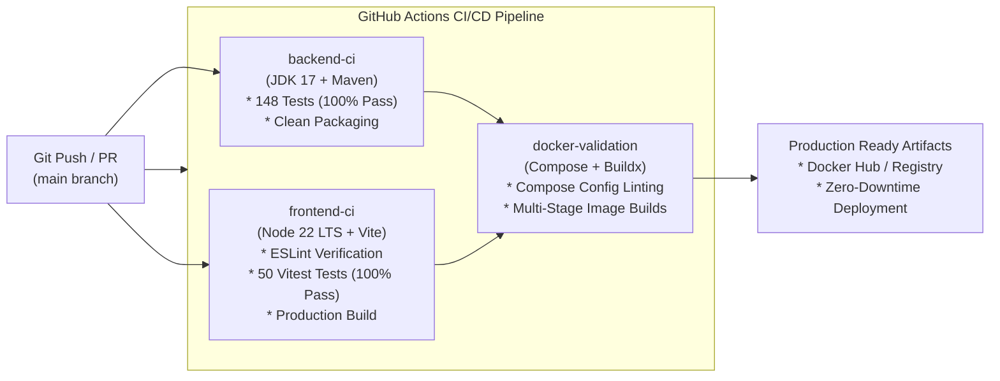

# LifeLink: Real-Time Emergency Blood Donation & Donor Response Platform
## Complete Implementation Report & Technical Documentation

---

### Executive Summary

**LifeLink** is a mission-critical, full-stack healthcare coordination platform designed to bridge the life-saving gap between hospitals facing acute blood shortages and volunteer blood donors. By pairing real-time geospatial matching (Haversine formula within a 20 km radius) with strict biological ABO/Rh compatibility filtering, live WebSocket push notifications, and a privacy-by-design contact disclosure model, LifeLink dramatically minimizes the response time for emergency transfusions.

This document serves as the comprehensive implementation report detailing the entire platform architecture, core business engines, enterprise security features, automated test suites, DevOps containerization, and continuous integration/continuous delivery (CI/CD) pipelines.

---

## 1. System Architecture & Tech Stack

```mermaid
flowchart TD
    subgraph ClientLayer ["Client Layer (Port 80 / 5173)"]
        Browser["Modern Web Browsers"]
        UI["React 19 + Vite SPA\nTailwind CSS + Lucide Icons"]
        STOMPClient["STOMP / SockJS WebSocket Client"]
    end

    subgraph GatewayLayer ["Reverse Proxy Gateway"]
        Nginx["Nginx 1.27 Alpine\nReverse Proxy & Static Web Server"]
    end

    subgraph BackendLayer ["Backend Application Server (Port 8080)"]
        Security["Spring Security 6 + JWT\nRateLimitingFilter (Sliding Window)"]
        Actuator["Spring Boot Actuator\n/actuator/health (Liveness/Readiness)"]
        Controllers["REST Controllers\nOpenAPI / Swagger Documentation"]
        Engines["Core Domain Engines\n* Haversine 20km Geolocation\n* ABO/Rh Compatibility Engine\n* Notification & WebSocket Broker"]
        JPA["Spring Data JPA + Hibernate\nOptimistic Locking (@Version)"]
    end

    subgraph DataLayer ["Data Persistence (Port 3307 / 3306)"]
        MySQL[("MySQL 8.0 Database\n(Production & Container)")]
        H2[("H2 In-Memory Database\n(Isolated Test Suites & CI)")]
    end

    Browser --> Nginx
    Nginx -->|/ (Static Assets)| UI
    Nginx -->|/api/* (REST Proxy)| Security
    Nginx -->|/ws/* (WebSocket Proxy)| Engines
    Nginx -->|/actuator/* (Health Proxy)| Actuator
    Security --> Controllers
    Controllers --> Engines
    Engines --> JPA
    JPA --> MySQL
    JPA -.->|Automated Tests| H2
```

### Complete Technology Matrix

| Layer | Technology | Version | Purpose |
| :--- | :--- | :--- | :--- |
| **Backend Framework** | Spring Boot | 4.1.1 (Spring 7) | Core microservice runtime & dependency injection |
| **Language Runtime** | Java (JDK) | 17 LTS (Eclipse Temurin) | High-performance enterprise runtime |
| **Security & Auth** | Spring Security + JJWT | 0.12.6 | Stateless JWT authentication & role-based authorization |
| **Persistence / ORM** | Spring Data JPA / Hibernate | 7.4.5.Final | Object-relational mapping, repositories, optimistic locking |
| **Database (Prod)** | MySQL Server | 8.0 | Relational database storage |
| **Database (Test)** | H2 In-Memory Database | 2.4.240 | Zero-dependency isolated database for test suites & CI |
| **Real-Time Push** | Spring WebSocket + STOMP | 4.1.1 | Event-driven push notifications to connected clients |
| **Observability** | Spring Boot Actuator | 4.1.1 | Container healthchecks, liveness & readiness probes |
| **API Documentation** | SpringDoc OpenAPI | 3.0.3 | Swagger UI specification & interactive exploration |
| **Frontend Framework** | React | 19.2.8 | Declarative single-page application |
| **Build Tooling** | Vite | 8.3.4 | Ultra-fast ES-module bundling & dev server |
| **Routing** | React Router DOM | 7.18.4 | Client-side routing with role-protected route guards |
| **WebSocket Client** | @stomp/stompjs | 7.3.0 | STOMP client over SockJS/WebSockets |
| **Frontend Testing** | Vitest + RTL | Vitest 5.1 / RTL 16.3 | Automated component & state unit testing |
| **Containerization** | Docker + Docker Compose | Multi-stage | Isolated development & production environments |
| **Web Server / Proxy** | Nginx | 1.27 Alpine | Production static hosting & preferential path routing |
| **CI/CD Pipeline** | GitHub Actions | Workflows v4 | Continuous integration, linting, tests & image build |

---

## 2. Core Platform Capabilities & Business Logic

### 2.1 Role-Based Access Control (RBAC)
The platform enforces three distinct personas secured by stateless JSON Web Tokens (JJWT):
1. **DONOR**:
   * Complete and update donor profile (blood group, address, latitude/longitude, phone, availability).
   * Receive real-time emergency match broadcasts.
   * Accept matches with an explicit **contact sharing consent toggle** or decline matches.
   * View personal donation history and earn achievement badges based on completed units.
2. **HOSPITAL**:
   * Complete hospital profile (institution name, registration license, address, coordinates, emergency phone).
   * Broadcast emergency requests (blood group, units needed, urgency: `LOW`, `MEDIUM`, `HIGH`, `CRITICAL`).
   * Trigger the automated matching engine.
   * Track donor responses in real time.
   * Access donor contact details **strictly after acceptance with donor consent**.
   * Mark donations completed, triggering automatic fulfillment once unit quotas are met.
   * Manually cancel active requests.
3. **ADMIN**:
   * Platform-wide oversight: total registered users, donors, hospitals, active emergencies, and fulfilled matches.
   * Administrative registry of all hospital profiles and active requests.
   * Pre-seeded administrative account (`admin@lifelink.com` / `Admin123`).

---

### 2.2 Geolocation Matching (Haversine Formula)
To ensure blood reaches patients within the critical golden hour, donors must be physically located within **20 km** of the requesting hospital. The distance is calculated using the spherical law of haversines:

$$\Delta\sigma = 2 \arcsin \left( \sqrt{ \sin^2\left(\frac{\Delta\phi}{2}\right) + \cos(\phi_1)\cos(\phi_2)\sin^2\left(\frac{\Delta\lambda}{2}\right) } \right)$$

$$d = R \cdot \Delta\sigma \quad (\text{where } R = 6{,}371\text{ km})$$

* Any donor whose distance $d > 20.0\text{ km}$ is strictly excluded by the matching engine.
* Inactive or unavailable donors (`available = false`) are automatically filtered out.

---

### 2.3 Strict Biological ABO / Rh Compatibility Matrix
LifeLink models strict real-world immunohematology rules to prevent hemolytic transfusion reactions:

| Patient / Request Blood Group | Compatible Donor Blood Groups | Universal Donor / Recipient Note |
| :--- | :--- | :--- |
| **O-** | `O-` | Universal donor to all; can receive only O- |
| **O+** | `O-`, `O+` | Compatible with all positive Rh groups |
| **A-** | `O-`, `A-` | Rh-negative A patient |
| **A+** | `O-`, `O+`, `A-`, `A+` | Rh-positive A patient |
| **B-** | `O-`, `B-` | Rh-negative B patient |
| **B+** | `O-`, `O+`, `B-`, `B+` | Rh-positive B patient |
| **AB-** | `O-`, `A-`, `B-`, `AB-` | Can receive from all negative groups |
| **AB+** | `O-`, `O+`, `A-`, `A+`, `B-`, `B+`, `AB-`, `AB+` | **Universal Recipient** (accepts all blood types) |

---

### 2.4 Privacy-by-Design Contact Disclosure Model
Donor contact details (phone number, email address) are high-sensitivity personal data:
* **Default State**: Contact numbers and emails are masked (`null`) in all responses to hospitals.
* **Match Creation**: When a match is found, status is `MATCHED`; contact information remains hidden.
* **Acceptance with Consent**: Only when the donor explicitly sets `status = ACCEPTED` and `consentToShareContact = true` does the backend unlock the `/api/emergency-requests/{requestId}/matches/{matchId}/contact` endpoint.
* **Pre-Consent & Cancellation Protection**: Attempting to query contact details for a non-accepted match or for a cancelled emergency request yields `409 Conflict` (`BusinessRuleException`).

---

### 2.5 Real-Time WebSocket & Push Notifications
* Configured using Spring WebSocket with STOMP protocol message broker.
* Backed by `SimpMessagingTemplate` pushing directly to user queues (`/queue/notifications`).
* Events broadcasted in real time:
  * `MATCH_FOUND`: Sent to matching donors when an emergency request is created.
  * `MATCH_ACCEPTED`: Sent to the hospital when a donor accepts.
  * `MATCH_REJECTED`: Sent to the hospital when a donor declines.
  * `REQUEST_CANCELLED`: Sent to matched donors when a hospital cancels a request.
  * `REQUEST_FULFILLED`: Sent to the hospital and participating donors when required units are reached.
* In-app bell notification dropdown updates unread count badges instantly without page refreshes.

---

### 2.6 Concurrency Protection via Optimistic Locking
To prevent race conditions where multiple coordinators or hospitals modify the same emergency request concurrently:
* `EmergencyRequest` entity utilizes `@Version private Long version;`.
* Concurrent saves against stale entity snapshots trigger `ObjectOptimisticLockingFailureException`, preventing lost updates.

---

## 3. Enterprise Hardening & New Additions

### 3.1 Spring Boot Actuator & Container Health Probes
Production microservices require health verification for orchestrators (Kubernetes, Docker Swarm, Docker Compose):
* **Dependency**: Integrated `spring-boot-starter-actuator`.
* **Endpoints Exposed**: `/actuator/health` and `/actuator/info`.
* **Configuration** (`application.properties`):
  ```properties
  management.endpoints.web.exposure.include=health,info
  management.endpoint.health.show-details=when-authorized
  management.endpoint.health.probes.enabled=true
  ```
* **Security Integration**: Whitelisted `/actuator/health/**` in `SecurityConfig.java` to allow orchestrator polling without authentication.
* **Nginx Reverse Proxy**: Added dedicated reverse proxy mapping in `nginx.conf`:
  ```nginx
  location /actuator/health {
      proxy_pass http://backend:8080/actuator/health;
  }
  ```
* **Docker Healthchecks**: Dockerfile and `docker-compose.yml` updated to probe `http://localhost:8080/actuator/health`.

---

### 3.2 Sliding-Window Rate Limiting & Brute-Force Defense
To defend authentication endpoints against credential stuffing and brute-force attacks:
* **Filter**: Implemented `RateLimitingFilter.java` extending `OncePerRequestFilter`.
* **Endpoints Throttled**: `/api/auth/login` and `/api/auth/register`.
* **Rule**: 10 requests per rolling 60-second window per client IP.
* **Reverse Proxy Support**: Extracts true client IP from `X-Forwarded-For` header with fallback to `request.getRemoteAddr()`.
* **Memory Protection**: Implemented a thread-safe sliding window with self-cleaning eviction:
  - Timestamp queue pruned on each request.
  - LRU/size eviction ensures cache never exceeds 5,000 IP entries, preventing memory exhaustion attacks.
* **HTTP 429 Response**: Rejects throttled requests with `429 Too Many Requests`, `Retry-After: 60`, and JSON error payload:
  ```json
  {"message": "Too many requests. Please wait before retrying."}
  ```
* **Unit Tests**: Built `RateLimitingFilterTest.java` (6 tests validating allow limits, IP isolation, window expiration, reverse proxy headers, and passthrough).

---

### 3.3 Automated Frontend Test Suite (Vitest + RTL)
Built 50 automated tests using Vitest and React Testing Library:
1. **`Badges.test.jsx` (13 tests)**:
   * Validates color semantics and rendering for `StatusBadge` (`ACTIVE`, `FULFILLED`, `CANCELLED`).
   * Validates `UrgencyBadge` (`CRITICAL`, `HIGH`, `MEDIUM`, `LOW`).
   * Validates `BloodGroupBadge` and `DonorLevelBadge` achievements.
2. **`AuthContext.test.jsx` (5 tests)**:
   * Validates token decoding, role parsing (`DONOR`, `HOSPITAL`, `ADMIN`), login state, logout cleanup, and session hydration from `localStorage`.
3. **`Modal.test.jsx` (4 tests)**:
   * Validates DOM portal mounting, backdrop clicks, Escape key dismiss, and close buttons.
4. **`ProtectedRoute.test.jsx` (3 tests)**:
   * Validates redirecting unauthenticated users to `/login`.
   * Validates role authorization checks (e.g. blocking DONOR from HOSPITAL pages).
   * Validates rendering children when authorized.
5. **`DonorDashboard.test.jsx` (12 tests)**:
   * Profile fetching, donor statistics, match list rendering.
   * Emergency notification banners.
   * Match acceptance flow with contact sharing checkbox.
   * Match rejection flow.
6. **`HospitalDashboard.test.jsx` (13 tests)**:
   * Hospital profile prompt guard.
   * Emergency request creation modal.
   * Triggering matching engine.
   * Donor contact fetching (with privacy disclosure checks).
   * Marking donation completed.

---

### 3.4 Integration & Concurrency Test Suite
1. **`EmergencyRequestConcurrencyTest.java`**:
   * Uses `@DataJpaTest` with isolated H2 in-memory DB.
   * Detaches an entity snapshot at version 0, simulates a concurrent thread saving version 1, and verifies that saving the stale snapshot throws `ObjectOptimisticLockingFailureException`.
2. **`EmergencyLifecycleIntegrationTest.java`**:
   * Comprehensive end-to-end integration test spanning the complete platform flow:
     - User registration & JWT generation for hospital and 3 donors.
     - Profile creation with precise GPS coordinates (Alice within 2 km, Bob incompatible blood group, Charlie > 60 km away).
     - Creation of emergency blood request.
     - Execution of matching engine: verifies only Alice matches (Haversine + ABO matrix).
     - Privacy guard verification: hospital receives `409 Conflict` if attempting to view Alice's contact before consent.
     - Donor acceptance with consent.
     - Hospital views unlocked contact details.
     - Hospital marks donation completed.
     - System automatically marks emergency request as `FULFILLED`.

---

## 4. DevOps, Docker Containerization & CI/CD Pipeline



### 4.1 GitHub Actions CI/CD Pipeline (`.github/workflows/ci.yml`)
* **Triggers**: On every `push` and `pull_request` to `main`, `master`, and `develop`.
* **Concurrency**: `cancel-in-progress: true` prevents wasted runner minutes.
* **Three Parallel & Gated Jobs**:
  1. `backend-ci` (Ubuntu Latest, JDK 17):
     * Caches Maven `.m2` repository dependencies.
     * Executes `./mvnw clean test` across all 148 tests.
     * Packages production executable JAR via `./mvnw package -DskipTests`.
  2. `frontend-ci` (Ubuntu Latest, Node.js 22 LTS):
     * Caches npm packages.
     * Runs `npm ci`.
     * Runs ESLint static code analysis.
     * Runs `npm test` (50 Vitest unit/component tests).
     * Builds production distribution bundle via `npm run build`.
  3. `docker-validation` (Ubuntu Latest, depends on `[backend-ci, frontend-ci]`):
     * Sets up Docker Buildx.
     * Validates production `docker-compose.yml` config.
     * Validates development `docker-compose.dev.yml` overlay.
     * Builds all Docker container images.

### 4.2 Modern Web Stream Resolution (Node 22 LTS)
During pipeline execution, Vitest utilizes `jsdom` which depends on `undici`. Undici requires `node:zlib.createZstdDecompress` (Zstandard decompression stream), introduced in Node.js 22.15+. We upgraded the CI runner and frontend Docker builder stages to **Node 22 LTS**, ensuring zero dependency crashes and modern web stream support.

### 4.3 Multi-Stage Docker Architecture
* **Backend Dockerfile**:
  - Stage 1: Maven packaging on Temurin 17.
  - Stage 2: Minimal Temurin 17 JRE Alpine runtime with non-root security user (`spring:spring`), memory limit flags, and curl-based healthcheck against `/actuator/health`.
* **Frontend Dockerfile**:
  - Stage 1: Build production bundle using `node:22-alpine`.
  - Stage 2: Serve static files with `nginx:1.27-alpine` containing custom reverse-proxy routing for `/api`, `/ws`, and `/actuator`.
* **Docker Compose**:
  - Runs MySQL (`lifelink-mysql` on port 3307), Backend (`lifelink-backend` on port 8080), and Frontend (`lifelink-frontend` on port 80).
  - Healthcheck dependency chain: Backend waits for MySQL to be healthy; Frontend waits for Backend to be healthy.

---

## 5. Quality Assurance & Test Verification Summary

| Test Domain | Test Framework | Test Count | Pass Rate | Execution Time | Key Coverage Areas |
| :--- | :--- | :---: | :---: | :---: | :--- |
| **Backend Unit & Controller** | JUnit 5 + Mockito + MockMvc | 146 | **100%** | ~14s | Auth, JWT, User, Hospital, Donor, Notification, Admin controllers and services |
| **Backend Concurrency** | JUnit 5 + Spring Data JPA | 1 | **100%** | ~4s | `@Version` optimistic locking under concurrent updates |
| **Backend Lifecycle E2E** | SpringBootTest + MockMvc | 1 | **100%** | ~9s | End-to-end emergency flow, Haversine exclusion, privacy guards, auto-fulfillment |
| **Rate Limiter Defense** | JUnit 5 + Mockito | 6 | **100%** | <1s | Sliding-window IP throttling, proxy header extraction, cache boundary |
| **Frontend Component & Unit** | Vitest + React Testing Library | 50 | **100%** | ~3s | Badges, AuthContext, Modals, ProtectedRoutes, DonorDashboard, HospitalDashboard |
| **CI/CD Pipeline** | GitHub Actions | 3 Jobs | **100% GREEN** | ~1m 7s | Backend build/test, Frontend lint/test/build, Docker verification |

---

## 6. API & Actuator Health Endpoint Matrix

| Method | Endpoint | Access Level | Purpose |
| :--- | :--- | :--- | :--- |
| `GET` | `/actuator/health` | Public | Liveness and readiness health probe |
| `GET` | `/actuator/info` | Public | Application metadata |
| `POST` | `/api/auth/register` | Public (Rate Limited) | Register a new user (`DONOR` or `HOSPITAL`) |
| `POST` | `/api/auth/login` | Public (Rate Limited) | Authenticate and obtain JWT token |
| `GET` | `/api/donor/profile` | `DONOR` | Fetch authenticated donor's profile |
| `PUT` | `/api/donor/profile` | `DONOR` | Update donor coordinates, blood group, contact, availability |
| `GET` | `/api/donor/matches` | `DONOR` | Fetch emergency matches assigned to the donor |
| `PATCH`| `/api/emergency-requests/matches/{id}/status` | `DONOR` | Accept (with consent toggle) or decline a match |
| `GET` | `/api/hospital/profile` | `HOSPITAL` | Fetch authenticated hospital's profile |
| `POST` | `/api/hospital/profile` | `HOSPITAL` | Register hospital profile |
| `POST` | `/api/emergency-requests` | `HOSPITAL` | Create a new emergency blood request |
| `GET` | `/api/emergency-requests` | `HOSPITAL` | Paginated list of hospital's emergency requests |
| `POST` | `/api/emergency-requests/{id}/match` | `HOSPITAL` | Trigger the Haversine + ABO matching engine |
| `GET` | `/api/emergency-requests/{id}/matches` | `HOSPITAL` | Fetch matches for an emergency request |
| `GET` | `/api/emergency-requests/{reqId}/matches/{matchId}/contact` | `HOSPITAL` | Get donor contact (**locked until donor accepts with consent**) |
| `PATCH`| `/api/emergency-requests/matches/{id}/complete` | `HOSPITAL` | Mark donation complete (auto-fulfills request when quota met) |
| `PATCH`| `/api/emergency-requests/{id}/status` | `HOSPITAL` | Manually cancel an active request |
| `GET` | `/api/admin/stats` | `ADMIN` | Platform-wide analytics and KPIs |
| `GET` | `/api/admin/hospitals` | `ADMIN` | Global registry of hospital accounts |
| `GET` | `/api/admin/requests` | `ADMIN` | Global registry of all emergency requests |
| `WS` | `/ws` (STOMP `/queue/notifications`) | Authenticated | Live push notifications |

---

## 7. How to Run the Project Locally

### Option A: One-Command Docker Full-Stack Run
```bash
docker compose up --build
```
* **Frontend Application**: `http://localhost:80`
* **Backend API & Swagger**: `http://localhost:8080/swagger-ui.html`
* **Actuator Health Probe**: `http://localhost:8080/actuator/health`
* **MySQL Database**: `localhost:3307`

### Option B: Local Development Run

1. **Start MySQL Database**:
   ```bash
   docker compose up -d mysql
   ```

2. **Run Backend (Spring Boot)**:
   ```bash
   cd blood-donor-system
   ./mvnw spring-boot:run
   ```

3. **Run Frontend (React + Vite)**:
   ```bash
   cd blood-donor-system/frontend
   npm install
   npm run dev
   ```
   Open `http://localhost:5173`.

4. **Execute All Automated Tests**:
   * Backend Tests (148 tests):
     ```bash
     cd blood-donor-system
     ./mvnw test
     ```
   * Frontend Tests (50 tests):
     ```bash
     cd blood-donor-system/frontend
     npm test
     ```
